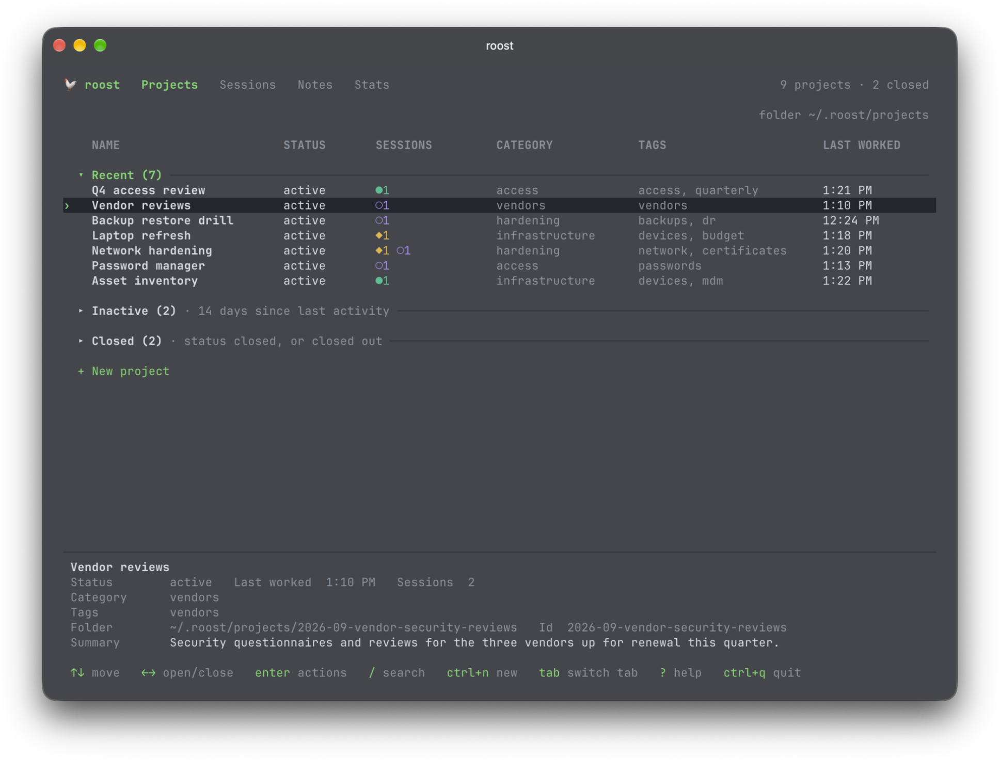
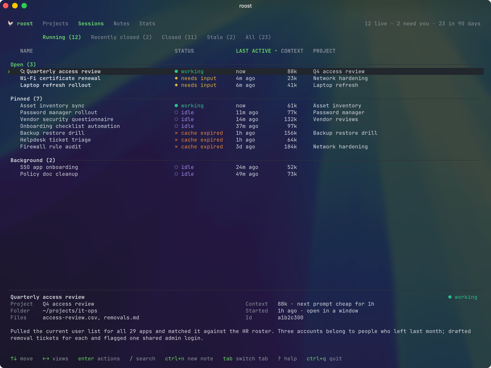
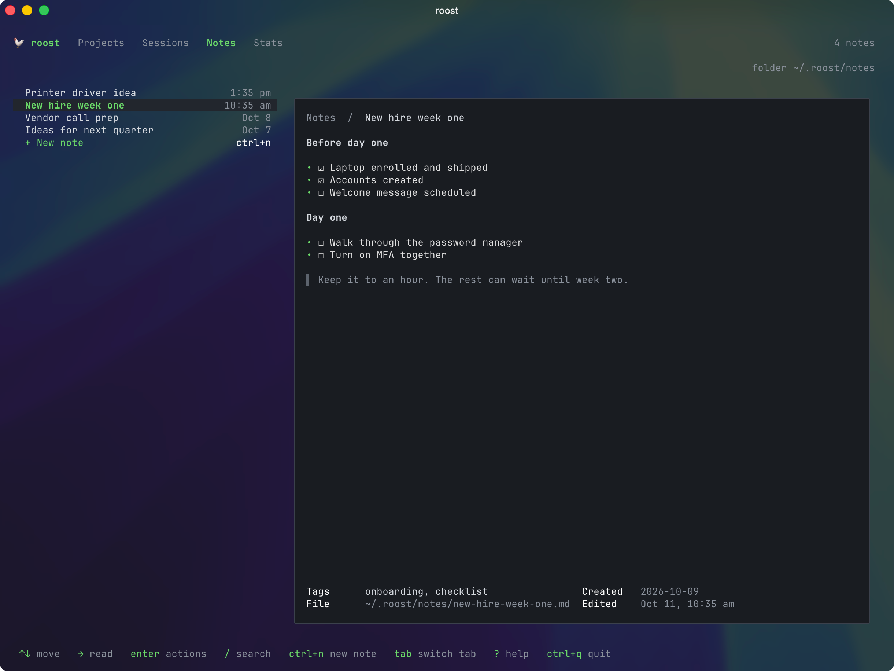
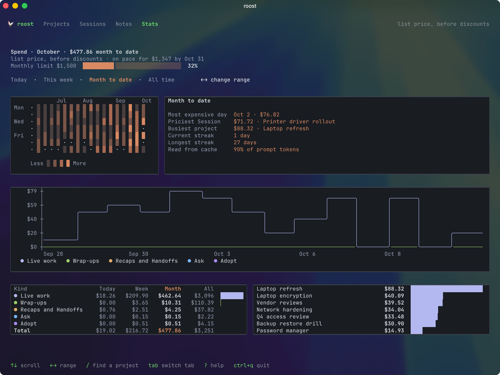
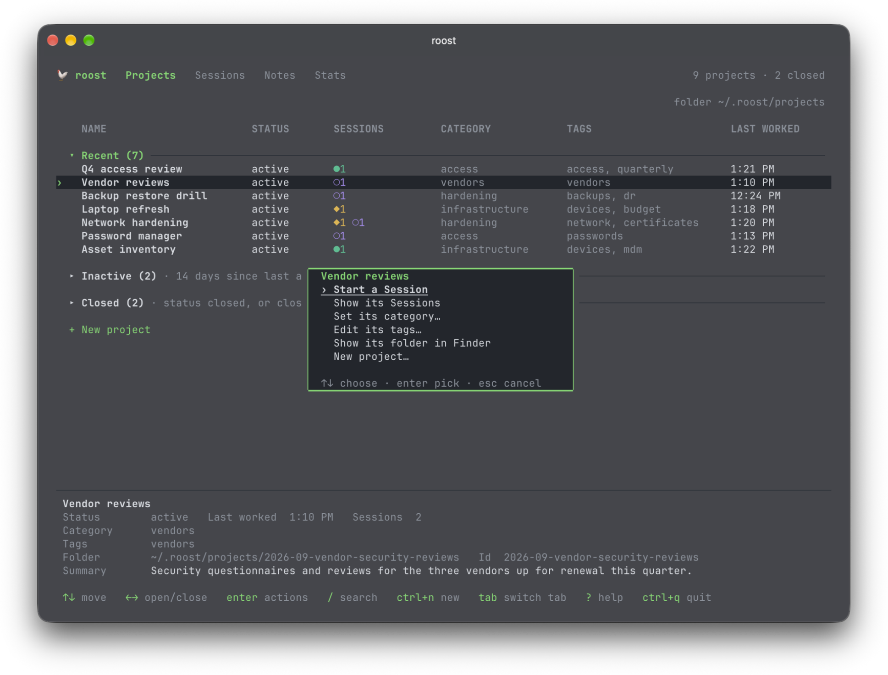
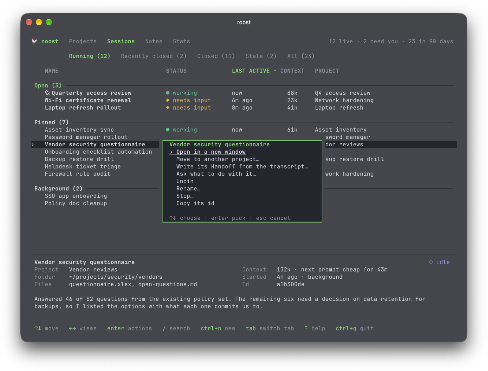

# Agent Roost

A terminal session manager for Claude Code. When you have a dozen or more Claude sessions running, roost shows them all in one table: what each is doing, when you last used it, how much context it holds, and whether it's open, pinned, or about to be closed for being idle. From there you can open, pin, stop, revive, or delete them.

Agent Roost is a session manager, not an orchestrator. It never sends work to a session on its own.



<p>
  
  
  
</p>

<p>
  
  
</p>

<sub>Projects, then Sessions, Notes, and Stats; below them, a project's and a Session's actions (Enter or right-click on a row). Screenshots are of `roost --demo`: made-up Sessions, projects, and notes.</sub>

## Install

Requires macOS, Python 3.9 or later (the system one is fine), and Claude Code with background sessions (`claude agents`). Agent Roost's screens are drawn by [Textual](https://textual.textualize.io), which Homebrew brings along or the install script puts in its own environment, `~/.roost/venv`, so nothing is added to your system Python.

With Homebrew:

```sh
brew install dmcphearson/tap/roost
roost setup   # once: checks prerequisites, picks the terminal and Projects folder, installs the plugin
```

Or with the install script, which needs only curl:

```sh
curl -fsSL https://raw.githubusercontent.com/dmcphearson/agent-roost/main/install.sh -o /tmp/roost-install.sh && sh /tmp/roost-install.sh
roost setup   # once: checks prerequisites, installs Textual, picks the terminal and Projects folder, installs the plugin
```

The script installs the latest release: its program files in `~/.roost/app/<version>` and the `roost` command in `~/.local/bin`. Saving it first means a failed download stops with curl's error instead of running a partial script, and you can read `/tmp/roost-install.sh` before the second half runs it.

**Updating:** with Homebrew, `brew upgrade roost`, then `roost update` to bring the plugin along. Otherwise, `roost update` installs the latest release, keeps the previous version's files and its launcher (as `~/.local/bin/roost.previous`), and brings Textual in `~/.roost/venv` to the version the release asks for (`roost setup textual` does only that). Agent Roost also checks once a day and says in its bottom bar when a new version is out.

**The plugin:** roost's skills (`/roost:pickup`, `/roost:wrap-up`, `/roost:note`) are a Claude Code plugin that ships in each release. `roost setup` puts it in `~/.roost/plugin` and registers it with Claude Code as `roost@roost`, through `claude plugin`; `roost setup plugin` does only that step. `roost update` swaps in the new release's plugin folder, then runs `claude plugin update` so Claude Code loads it; it changes nothing in Claude Code's settings. Running Sessions keep the old plugin until they're restarted or you run `/reload-plugins` in them.

### Developing

Clone this repo and run `./dev-link.sh`. It links `~/.local/bin/roost` and `~/.roost/plugin` to your checkout so edits take effect immediately. `roost update` and `install.sh` both refuse to replace a dev link. Then run `roost setup plugin` once to register the linked plugin with Claude Code.


## Use

| Command | What it does |
|---|---|
| `roost` | Open the session browser |
| `roost <text>` | Open it with a search applied |
| `roost --list` | Plain-text listing, for scripts |
| `roost --demo` | Made-up sessions for screenshots; nothing real is read or changed |
| `roost --version` | Print the version |
| `roost setup` | Check prerequisites, choose a terminal and the Projects folder, and install the plugin |
| `roost update` | Install the latest release and bring the plugin along (Homebrew: `brew upgrade roost` first) |
| `roost project new <id> [--description "…"]` | Make a project folder and its README (`<project>/<slug> --type <type>` makes a sub-project); `brief`, `list`, `status`, and `description` read and set the rest |
| `roost note "title" [text]` | Save a note to the Notes tab, or pipe its text in |
| `roost ledger <id>` | Print a project's timeline: every Handoff's facts, oldest first |
| `roost handoff` | Write a Session's Handoff from a summary on stdin (`--roll-up`: a finished sub-project's roll-up, into its parent); `/roost:wrap-up` runs it |
| `roost adopt [<folder>]` | Bring existing project folders into roost's project layout: shows the cost, plans each one, and applies a plan only after you approve it; replaced files go to the project's `_archive/<date>/` |

### Views and sections

Tabs: **Running**, **Recently closed** (last 3 hours), **Closed**, **Stale**, and **All**. **Stale** lists sessions over 150k tokens that nobody has touched in 2 days or more. Their knowledge belongs in files, not in a session you pay to rebuild. Running sessions are grouped into:

- **Open**: a terminal window has the session
- **Pinned**: running in the background and never closed for being idle
- **Background**: running in the background; Claude Code closes these after about an hour idle

Closed sessions come after them, and **Dismissed** ones last: a closed session you don't plan to wrap up can be dismissed from its actions, and Undismiss brings it back. Dismissing changes nothing but roost's list (`~/.roost/dismissed.json`): the transcript and the project's README stay as they are.

### Keys

roost is a sidebar and a right pane. The sidebar lists your projects, then Sessions, Notes, and Stats; the selected one shows in the right pane. The keys are the same everywhere. Everything you can do to a row is in its actions.

| Key | Action |
|---|---|
| ↑ ↓ | Move |
| Page Up, Page Down / Option+↑ ↓ | Move a screen |
| Home / End | Top / bottom |
| ← → | Sessions: switch views (Running, Recently closed, Closed, Stale, All) · Projects: open or close a section · Notes: read the note |
| Enter / right-click | Open the selected row's actions |
| Double-click | Run the row's first action: open a Session, start one for a project, or edit a note |
| / | Search the view in the right pane |
| ctrl+n | New, from anywhere: a Project (P), a Session in a folder you name (S), or a Note (N). The letter or ↑↓ and Enter picks |
| Esc | Close a list or prompt, or clear the search. It never quits |
| Tab / Shift+Tab | Move between the sidebar and the right pane (on Sessions, Notes, or Stats; Enter moves in too, Esc back) |
| ? | Show the keys |
| Ctrl+q | Quit (a plain q does nothing) |

**A Session's actions:** Open (or go to its window), New project from this Session, Add to a project (or move to another), Write its Handoff or Session recap from the transcript (shows the cost first), Ask what to do with it, Pin or Unpin (on a closed one, restart it in the background, pinned), Rename, Dismiss or Undismiss (a closed one), Stop or Delete to the Trash (both ask first), Copy its id, and Show its folder in Finder. A closed Session a project lists isn't reopened; its first action starts a fresh Session for the project. A Session with a recap can read it, make it a project (the recap's Handoffs move in), or start a fresh Session from it.

**Ask what to do with it** has a model read the Session's transcript and your open projects (it shows the cost first) and comes back with a verdict and why: delete it, write its Session recap, write its Handoff, add it to one of your projects, or leave it as it is, with its open items and anything you'd lose by deleting it. The advised choice is selected in a menu of every choice; nothing happens until you pick one, and anything that spends or deletes asks again.

**A project's actions:** Start a Session, Start a Session in a sub-project, Show its Sessions (the Sessions tab, on All, searching `project:<its id>`; esc clears it); New sub-project; Set its category, Edit its tags, Edit its description (one optional sentence; `/wrap-up` writes it when it's empty), Rename (its label, the name roost shows, then its folder; not while a Session runs in it), Show its folder in Finder; then Adopt it (a folder not yet in roost's layout: plans its README and files, you review the plan, then it writes its Handoffs), clear an old `_archive/` from roost adopt, and Delete to the Trash (asks first, then you type its name; its sub-projects go with it). Each menu's groups are split by a line: working on it, organizing it, then removing it. **+ New project**, at the bottom of the list, makes one too.

A project has one category (what kind of work it is), its README's `category:` line, and any number of tags (what it's about), its `tags: [a, b]` list. Set its category lists the categories in `CATEGORIES.md` in your Projects folder, one `- name: what it covers` line each, plus any other a project uses; a new one you type joins the list. Edit its tags ticks tags from every tag already in use, or adds a new one. Sessions are listed under the sidebar's Sessions entry. Select a project in the sidebar and its details show beside it. A row's marks at the right say what's going on in it: ● a Session is running, ◆ it's ready to pick up (nothing running, and a Handoff covers its newest Session); a project with its sub-projects folded shows theirs too. The details' Sessions field counts its running Sessions (◆ need input · ● working · ○ idle), then its unwrapped ones: closed, with no Handoff covering their last message, and not dismissed. Under its fields, the details list a project's open sub-projects (running, or ready with the age of their Handoff), its Sessions running or active in the last 7 days, its newest Handoffs, its notes, and this month's spend; a README's `repo:` shows as Repo. A status bar above the keys says how many Sessions are running; a click on it lists them. Dates in the lists and panels are a time today (2:17 PM) and a date otherwise, month or day first as your locale has it (10/14/26 or 14/10/26). A Session recap (what `/wrap-up` writes for a Session no project lists) shows in its Session's panel, and the Session's actions can read it or make it a project.

**Sub-projects** split a project's work into pieces a Session can start on, finish, and close: a feature, a bugfix, research, or a chore. Each is a folder in the project's `sub/` with its own README and `handoffs/`, and its id is `<project>/<slug>`. Make one with `roost project new <project>/<slug> --type feature --description "…"`. `/roost:pickup <project>/<slug>` reads the parent project's README first, so the Session keeps the project's goals in view, then the sub-project's README and newest Handoffs, then the project's other open sub-projects; it leaves out the parent's Handoffs. `/wrap-up` writes the Session's Handoff into the sub-project. When a Session finishes one (its status set to `done`, after it asks), it also writes a roll-up into the parent project's Handoffs, with `roost handoff --roll-up`: what the sub-project set out to do, what shipped, the decisions to keep, and what's left open; then it updates the parent README's Current state and Key decisions. The parent learns what its sub-projects did without carrying their history. `roost project list` shows open sub-projects under their project; status `done` hides one.

On the Projects tab, a project with open sub-projects is marked ▸; → shows them under it and ← hides them; a sub-project's details show its type. A project's actions add New sub-project (its type, slug, and an optional one-sentence description) and Start a Session in a sub-project; a sub-project's row shows its label, and its own actions are Start a Session, Show its Sessions, Edit its tags, Edit its description, Rename, Show its folder in Finder, and Delete to the Trash (asks first, then you type `<project>/<slug>`). A search shows matching sub-projects under their project, and `type:bugfix` finds sub-projects by type. A Session listed in a sub-project belongs to it: its PROJECT is `<project>/<slug>`, `project:<project>` finds it too, and Add to a project or Move to another project can put a Session in a sub-project.

### Notes

Notes is your scratchpad: ideas and things to come back to, saved from anywhere in roost or by an agent. Each note is a Markdown file in `~/.roost/notes/`. It may grow into a project, move into one, or get deleted when it's no longer needed. Ctrl+n then N from anywhere, or **+ New note** at the bottom of the Notes list, asks for a title, creates the file with its frontmatter (`title`, `created`, `project`, `sessions`, and `tags`), and opens it in your editor with the cursor under the title.

The tab lists your notes, newest edit first. A note has tags but no category; its actions include Edit its tags, which picks from the same library and writes `tags: [a, b]`. The selected note shows in a reading card beside the list (under it, when the right pane is narrower than 86 columns), with its Markdown laid out: headings, bold, code, bullets, checkboxes, and quotes. The footer holds its facts: the file, when it was created and last edited, its tags, and any other frontmatter fields. In the list, the card shows a long note's first 80 lines; → moves into the card to read all of it, scrolling with ↑ ↓ and Page Up and Page Down; ← or Esc moves back to the list.

From the shell, `roost note "Printer driver idea" Push it from the MDM` saves a note (or pipe its text in). In a Session, ask Claude to save an idea for later, or run `/roost:note`.

**A note's actions:** Edit, Start a Session from it (its first prompt reads the note), Move to a project (it leaves Notes for the project's `notes/` folder), Make it a project (the note moves into the new project's `notes/`), Show it in Finder, and Delete to the Trash (asks first).

**Session recaps are notes too.** Wrapping up a Session that no project lists writes its Handoff to a note named after the Session and tagged `recap`; later wrap-ups add to the end of the same note. The Session's panel still shows it. Make it a project moves the recap's Handoffs into the new project's `handoffs/`. Recaps from before this release move from `~/.roost/sessions/` into `~/.roost/notes/` the first time roost runs.

Agent Roost opens notes in the `editor` setting in `~/.config/roost/config.json`, else `$VISUAL`, else `$EDITOR`, else [micro](https://micro-editor.github.io) (`brew install micro`). It waits for an editor in the terminal and gets out of the way of one with its own window (VS Code, Zed, and the like); `editor_wait` (true or false) overrides that. Agent Roost never edits a note itself, except for setting its `project:` line when you move it.

### Stats

What your Sessions cost: every reply's tokens at Anthropic's list price, before any discount, so it's a ceiling, not your invoice. ← → picks the range: Today, This week (from Monday), Month to date, or All time (as far back as Claude Code keeps transcripts). The tab shows the month's spend and its pace, a calendar of spend by day, the most expensive day, Session, and project, your streaks, how much of your prompt tokens came from the cache, and spend by day split by kind: Live work, Wrap-ups (after `/wrap-up`), and roost's own calls for Recaps and Handoffs, Ask, and Adopt (logged in `~/.roost/spend.jsonl` as they run). `/` narrows the spend-by-project list to the projects you type. Set `monthly_limit` (below) to see the month against it.

### Settings

`roost setup` writes the first two; the rest are optional. All live in `~/.config/roost/config.json`.

| Setting | What it does |
|---|---|
| `terminal` | Where sessions open: `ghostty`, `terminal`, or `iterm2` |
| `projects_dir` | Your Projects folder (default `~/.roost/projects`) |
| `editor`, `editor_wait` | The editor notes open in, and whether roost waits for it (see Notes) |
| `summary_model` | The model that writes Handoffs, recaps, and adopt plans and answers Ask (default `claude-sonnet-5-5`) |
| `summary_budget_usd` | The most one of those runs may spend, in dollars (default 5) |
| `monthly_limit` | A monthly budget in dollars: the Stats tab shows month to date against it |
| `adopt_archive_days` | Days before roost suggests clearing an `_archive/` from roost adopt (default 5) |

While a Handoff is being written from a transcript, the row counts up: `summarizing 2/3 · 1m40s` (the draft, the review, then the README).

Click a column header to sort by it, and click again to reverse.

## Terminals

Ghostty, Terminal.app, and iTerm2 can open sessions in new windows. Choose one with `roost setup`; the choice is saved in `~/.config/roost/config.json`. With no terminal configured, Enter opens the session in the current terminal. In an IDE's terminal (IntelliJ and the other JetBrains IDEs, VS Code, Cursor), which roost can't open a tab in, it copies the command that runs the session instead and says how to open a new tab to paste it in; roost keeps running.

## How it works

Agent Roost reads Claude Code's local state. It calls a model only when you ask for a Handoff, a Session recap, an adopt plan, or what to do with a Session, shows the estimated cost first, and logs what each call cost in `~/.roost/spend.jsonl`. Everything else comes from:

- `claude agents --json` for live sessions and their status
- `~/.claude/projects/**/*.jsonl` transcripts for names, summaries, files touched, and context size (cached in `~/.cache/`)
- `~/.claude/jobs/pins.json` for pins, written with the same lock Claude Code uses
- `claude --bg --resume`, `claude stop`, and `claude rm` to revive, stop, and clean up sessions
- `curl` to github.com for installs, updates, and the daily new-version check
- a daily fetch of Anthropic's pricing page (platform.claude.com), for those cost estimates

roost runs its commands on any Python 3.9 or later. For the screens it starts again on the Python in `~/.roost/venv`, where Textual is installed.

Several of these are internal to Claude Code and can change between releases. If roost starts showing wrong states after a Claude Code update, check those first.

### Cache and cost

Claude keeps each session's context in the prompt cache after every request. **STATUS** gives each state its own word, symbol, and color, so it reads without color too:

| Status | Meaning |
|---|---|
| `● working` (green) | Claude is working |
| `◆ needs input` (yellow) | Waiting on you |
| `○ idle` (purple) | Waiting for a prompt, and the next one is cheap |
| `◔ expires in 8m` (sky blue) | The next prompt is cheap for 8 more minutes |
| `✕ cache expired` (vermillion) | Expired: the next prompt costs about 2×. Its actions can write its Handoff from the transcript instead |
| `· closed` (grey) | Not running |

On 256-color terminals the colors come from the Okabe-Ito palette, chosen to stay distinguishable with the common kinds of color blindness. While it's warm, the next message reads the context back at about 0.1× the normal input price. Once it's cold, the next message writes the whole context again: about 2× on the 1-hour cache, 1.25× on the 5-minute one. Agent Roost reads which cache a session uses from its transcript. The bottom line of the detail panel shows the exact time left and that cost for the selected session, and it tells you when a big session is a good moment to wrap up or compact: shortly before it goes cold, or once it has gone stale.

### Session life

Claude Code deletes a session's history 30 days after it was last used (the `cleanupPeriodDays` setting; Claude Desktop sessions are kept). For closed sessions, the detail panel shows the days left: yellow at 20 or fewer, red at 10 or fewer. Restarting it from its actions resets the clock. Running sessions show no countdown, since Claude's docs don't say how cleanup treats them.

## When something looks wrong

Agent Roost logs failed actions and compatibility warnings to `~/.cache/roost.log`. At startup it compares the Claude Code version and the fields in `claude agents --json` with what it was tested against, and shows a yellow warning in the bottom bar if they differ.

## Tests

```sh
~/.roost/venv/bin/python -m unittest discover -s tests < /dev/null
```

Under a Python without Textual, the tests of the Textual screens are skipped. The tests use demo data and temporary files only; they never touch your real sessions.


## License

Apache License 2.0: see [LICENSE](LICENSE) and [NOTICE](NOTICE). Releases up to 2026.10.22 were published under MIT and stay MIT for anyone who has them. The name "Agent Roost" and its logo and icon are not licensed with the code: see [TRADEMARKS.md](TRADEMARKS.md). Issues are welcome; code pull requests are by arrangement.
